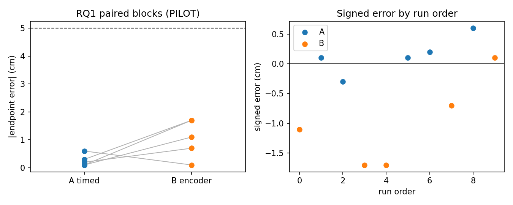
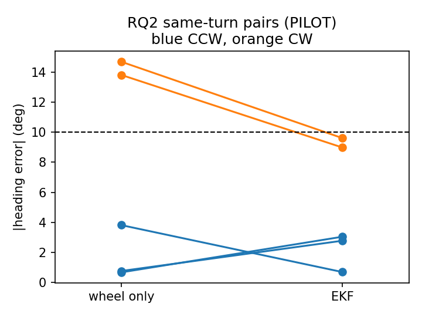

# WALL-E pilot summary

**PILOT RESULTS: feasibility-scale, not main-study evidence. Do not claim statistical significance from these numbers; report intervals and what the full study needs.**

## RQ1: endpoint distance error (A timed vs B encoder-targeted)

**Strategy A**: attempted 5, externally invalid 0, failed 0 (none), endpoint missing 0, success 5/5  
|error|: n=5, mean 0.26 cm, median 0.20 cm, SD 0.21, 95% CI [0.00, 0.52], max 0.60 cm  
signed error: n=5, mean 0.14 cm, median 0.10 cm, SD 0.32, 95% CI [-0.26, 0.54], max 0.60 cm  
|lateral|: n=5, mean 1.50 cm, median 2.30 cm, SD 1.33, 95% CI [-0.15, 3.15], max 2.70 cm  
completion time: n=5, mean 2.07 s, median 2.08 s, SD 0.01, 95% CI [2.06, 2.09], max 2.09 s

**Strategy B**: attempted 5, externally invalid 0, failed 0 (none), endpoint missing 0, success 5/5  
|error|: n=5, mean 1.06 cm, median 1.10 cm, SD 0.68, 95% CI [0.21, 1.91], max 1.70 cm  
signed error: n=5, mean -1.02 cm, median -1.10 cm, SD 0.76, 95% CI [-1.96, -0.08], max 0.10 cm  
|lateral|: n=5, mean 0.98 cm, median 0.20 cm, SD 1.08, 95% CI [-0.36, 2.32], max 2.40 cm  
completion time: n=5, mean 2.02 s, median 2.03 s, SD 0.02, 95% CI [2.00, 2.05], max 2.05 s

Paired blocks planned 15, complete pairs 5 (failures with measurable endpoints included).

- complete pairs: 5
- mean paired difference -0.80 cm (positive favors the second option), unadjusted two-sided 95% t interval [-1.84, +0.24]
- one-sided paired t: t = -2.13, p = 0.9499; Holm-adjusted p = 0.9499; Cohen's dz = -0.95
- sensitivity: paired sign-flip p = 0.9688 (assumes symmetric, exchangeable signs; limited by n)
- effect of interest: 2.0 cm. Interpret the interval against it; a nonsignificant result does not establish equivalence.

## RQ2: heading-estimate error (wheel only vs EKF, same turn)

attempted 5, externally invalid 0, failed 0, endpoint missing 0  
true turn magnitude: n=5, mean 82.60 deg, median 86.00 deg, SD 7.02, 95% CI [73.88, 91.32], max 89.00 deg  
wheel |error|: n=5, mean 6.75 deg, median 3.82 deg, SD 6.98, 95% CI [-1.91, 15.42], max 14.70 deg  
EKF |error|: n=5, mean 5.02 deg, median 3.04 deg, SD 4.02, 95% CI [0.03, 10.01], max 9.61 deg  
wheel signed: n=5, mean -4.66 deg, median 0.67 deg, SD 8.86, 95% CI [-15.66, 6.35], max 3.82 deg  
EKF signed: n=5, mean -5.02 deg, median -3.04 deg, SD 4.02, 95% CI [-10.01, -0.03], max -0.69 deg

- ccw: n=3; wheel n=3, mean 1.75 deg, median 0.76 deg, SD 1.79, 95% CI [-2.70, 6.20], max 3.82 deg; EKF n=3, mean 2.17 deg, median 2.78 deg, SD 1.29, 95% CI [-1.03, 5.37], max 3.04 deg
- cw: n=2; wheel n=2, mean 14.26 deg, median 14.26 deg, SD 0.62, 95% CI [8.68, 19.84], max 14.70 deg; EKF n=2, mean 9.30 deg, median 9.30 deg, SD 0.44, 95% CI [5.32, 13.28], max 9.61 deg

- complete pairs: 5
- mean paired difference +1.73 deg (positive favors the second option), unadjusted two-sided 95% t interval [-2.82, +6.29]
- one-sided paired t: t = 1.06, p = 0.1751; Holm-adjusted p = 0.3503; Cohen's dz = 0.47
- sensitivity: paired sign-flip p = 0.1562 (assumes symmetric, exchangeable signs; limited by n)
- effect of interest: 4.0 deg. Interpret the interval against it; a nonsignificant result does not establish equivalence.

## RQ3: ranging (exploratory, descriptive only)

placements planned 64, analyzed 0, externally invalid 0

**ultrasonic**: valid 0/0, joint success (valid and APE <= 15.0%) 0/0  
AE: no data  
APE: no data  
latency: no data

**camera**: valid 0/0, joint success (valid and APE <= 15.0%) 0/0  
AE: no data  
APE: no data  
latency: no data

Common-valid placements: 0 (may select easier placements; read with availability).  
AE difference, camera - ultrasonic: no data  
APE difference, camera - ultrasonic: no data (reference effect of interest 5.0 pp)

| object | ultrasonic valid | ultrasonic median APE | camera valid | camera median APE |
|---|---|---|---|---|

| angle | ultrasonic valid | ultrasonic median APE | camera valid | camera median APE |
|---|---|---|---|---|

| distance | ultrasonic valid | ultrasonic median APE | camera valid | camera median APE |
|---|---|---|---|---|

## Ground-truth quality

repeatability (pooled SD by quantity and measurer): {}  
double-measured disagreement: {}

## Figures

